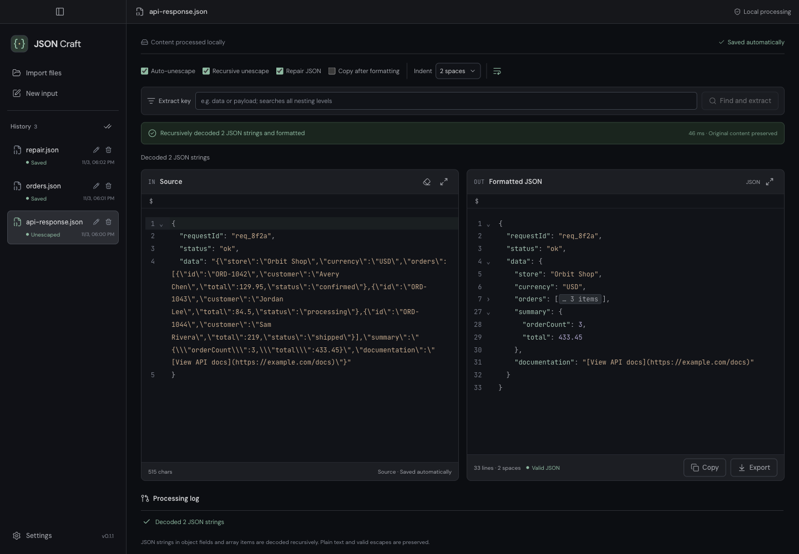
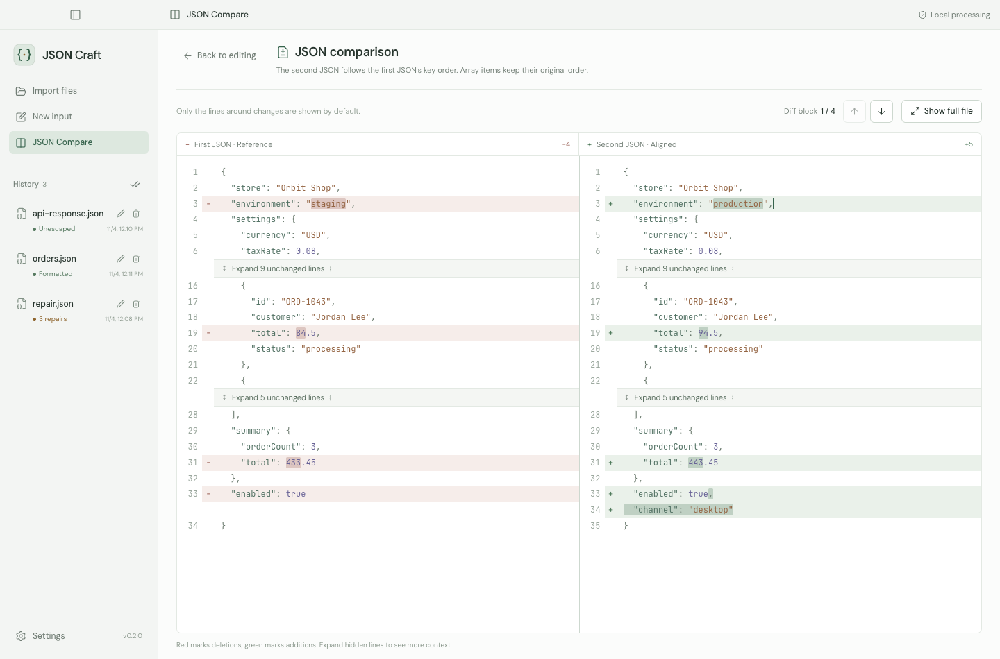
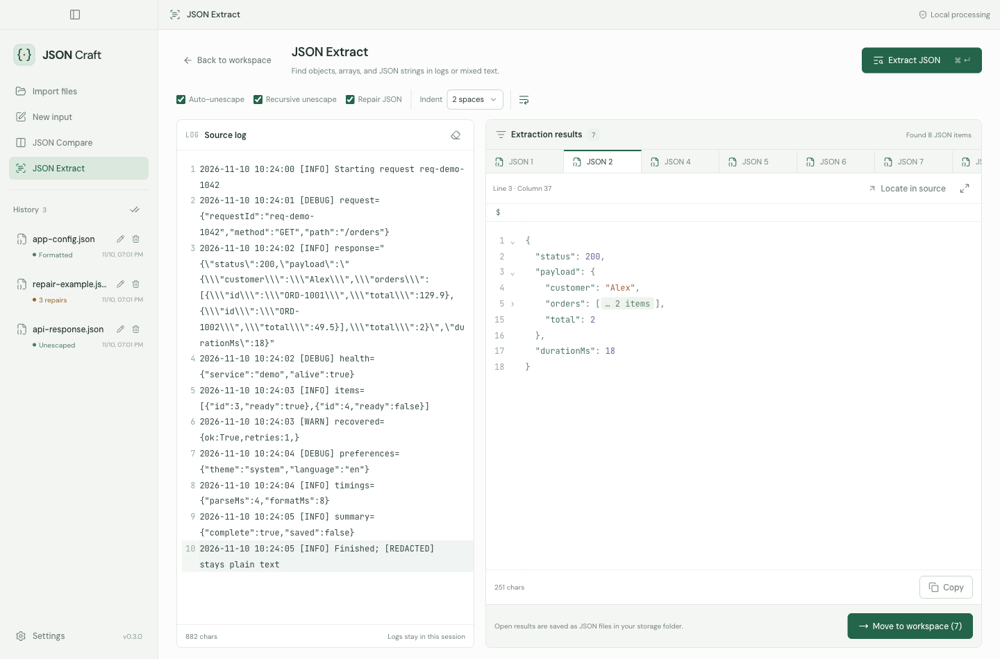
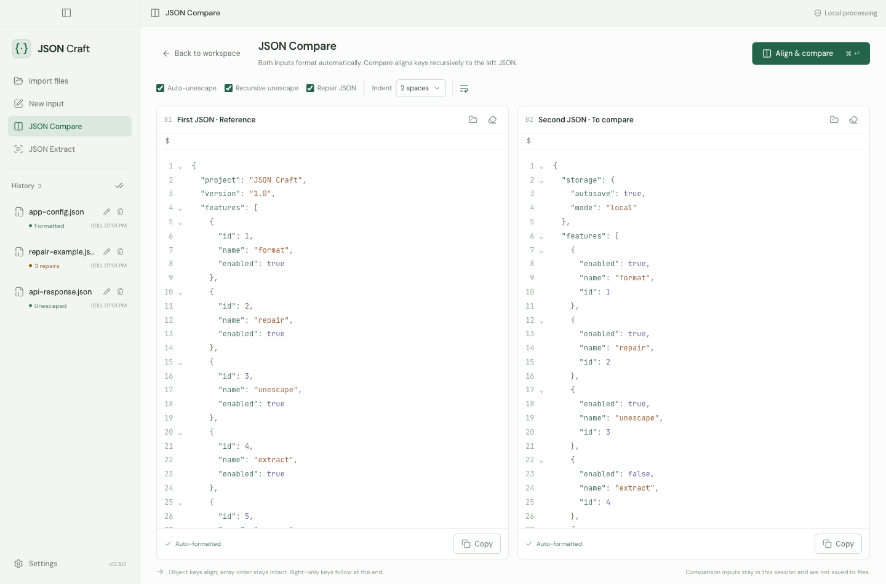
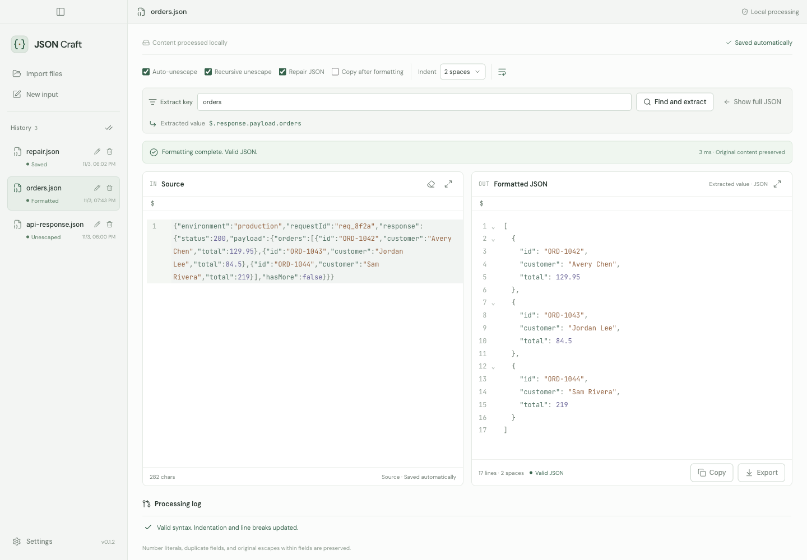
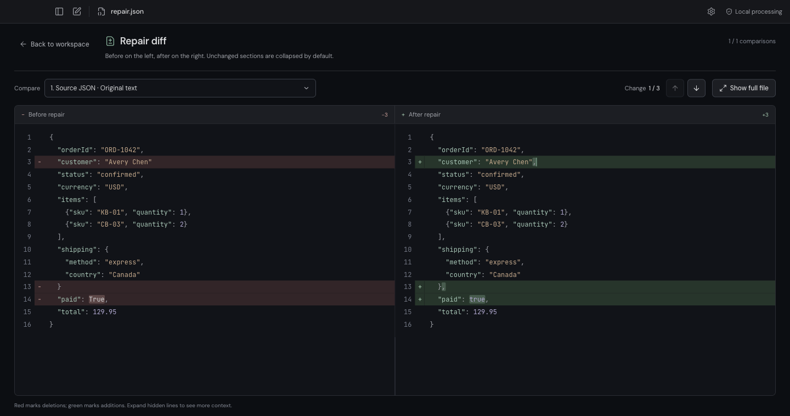
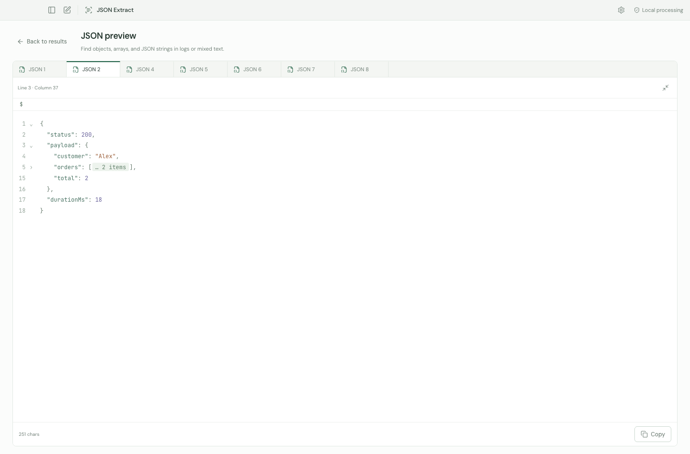

**English** | [简体中文](README.zh-CN.md)

# JSON Craft

### Offline JSON Formatter, Repair, Diff & Log Extractor

A JSON workbench for macOS and Windows. Format, repair, compare and extract JSON — all on your device, without uploading your data.

  
  

[Download](https://github.com/HANYIIK/json-craft/releases/latest) · [Report an issue](https://github.com/HANYIIK/json-craft/issues)

If you find JSON Craft useful, please give it a [⭐ on GitHub](https://github.com/HANYIIK/json-craft).

## Features

| Feature                   | What you can do                                                                                                        |
| ------------------------- | ---------------------------------------------------------------------------------------------------------------------- |
| **Format & decode**       | Make compact JSON readable. Unwrap an outer JSON string, or recursively expand JSON strings inside objects and arrays. |
| **Repair JSON**           | Fix common syntax errors and review every change in a side-by-side diff.                                               |
| **JSON Compare**          | Compare two documents without differences caused only by object key order. Array order is preserved.                   |
| **JSON Extract**          | Find multiple JSON objects, arrays and encoded JSON strings in logs. Preview, copy or save the results.                |
| **Extract by key**        | Find a field at any depth and work with its value. Choose a path when the same key appears more than once.             |
| **Editing & files**       | Search and replace, fold sections, jump to parent keys, expand an editor, and manage saved files.                      |
| **Appearance & language** | Light and dark themes, system preferences, and instant switching between English and Simplified Chinese.               |

No account or internet connection is needed. Supports UTF-8 JSON files up to **20 MiB** each.

## Download

| Platform                  | Installer                                                                                                                                                                                                       |
| ------------------------- | --------------------------------------------------------------------------------------------------------------------------------------------------------------------------------------------------------------- |
| macOS 13+ · Apple Silicon | [DMG](https://github.com/HANYIIK/json-craft/releases/download/v0.3.0/JSON-Craft-0.3.0-macOS-arm64.dmg) · [ZIP](https://github.com/HANYIIK/json-craft/releases/download/v0.3.0/JSON-Craft-0.3.0-macOS-arm64.zip) |
| macOS 13+ · Intel         | [DMG](https://github.com/HANYIIK/json-craft/releases/download/v0.3.0/JSON-Craft-0.3.0-macOS-x64.dmg) · [ZIP](https://github.com/HANYIIK/json-craft/releases/download/v0.3.0/JSON-Craft-0.3.0-macOS-x64.zip)     |
| Windows · x64             | [EXE](https://github.com/HANYIIK/json-craft/releases/download/v0.3.0/JSON-Craft-0.3.0-Windows-x64.exe)                                                                                                          |
| Windows · ARM64           | [EXE](https://github.com/HANYIIK/json-craft/releases/download/v0.3.0/JSON-Craft-0.3.0-Windows-arm64.exe)                                                                                                        |

**macOS:** Open the DMG and drag JSON Craft into Applications, or unzip the ZIP. These builds are not notarized by Apple; if the first launch is blocked, see [Apple’s opening instructions](https://support.apple.com/en-us/102445).

**Windows:** Run the EXE installer. These builds are unsigned, so Windows may display an unknown-publisher or SmartScreen warning.

Checksums are available in `SHA256SUMS` on the [release page](https://github.com/HANYIIK/json-craft/releases/latest).

## Get started

1. Paste JSON into **Source**, import a file, or drag files into the app. The formatted result updates automatically.
2. Choose whether to decode embedded JSON strings or repair invalid syntax, then **Copy** or **Export** the result.
3. Open **JSON Compare** for two-document comparisons, or **JSON Extract** to find JSON in pasted logs.

### Compare JSON

Paste or import a document on each side, then click **Align & compare**. Review additions and deletions, jump between changes, or expand unchanged sections for context.

### Extract JSON from logs

Paste your logs and click **Extract JSON**. Browse the results in tabs and close any you do not need. Click **Move to workspace** to save the remaining results as JSON files.

## Saving your work

Workspace inputs are automatically saved as `.json` files in your chosen folder; formatted results are available through **Copy** or **Export**. Comparison drafts and log extraction results last only for the current session — move extracted results to the workspace to keep them after closing the app.

More screenshots

## Feedback

Have a question, found a bug, or need a feature? [Open an issue](https://github.com/HANYIIK/json-craft/issues).
