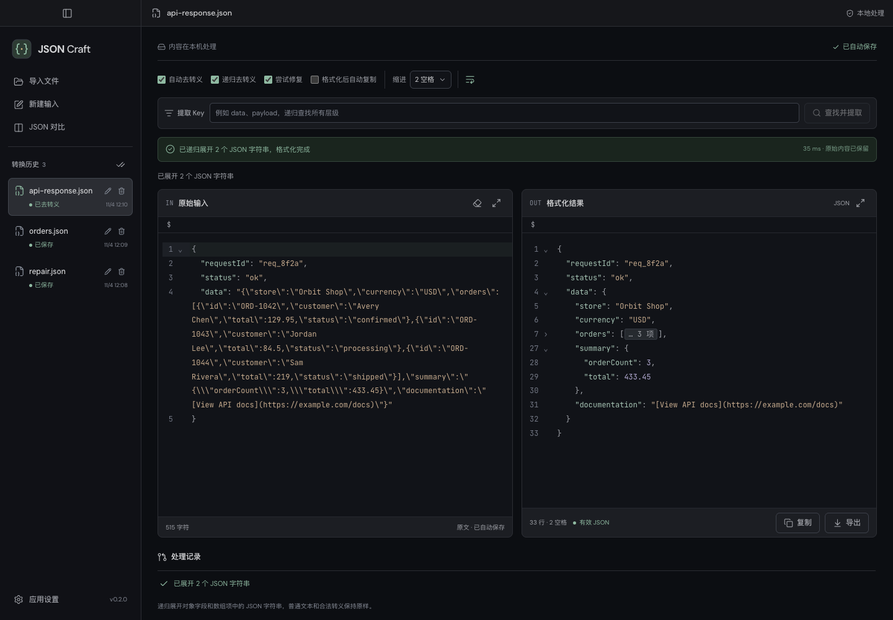
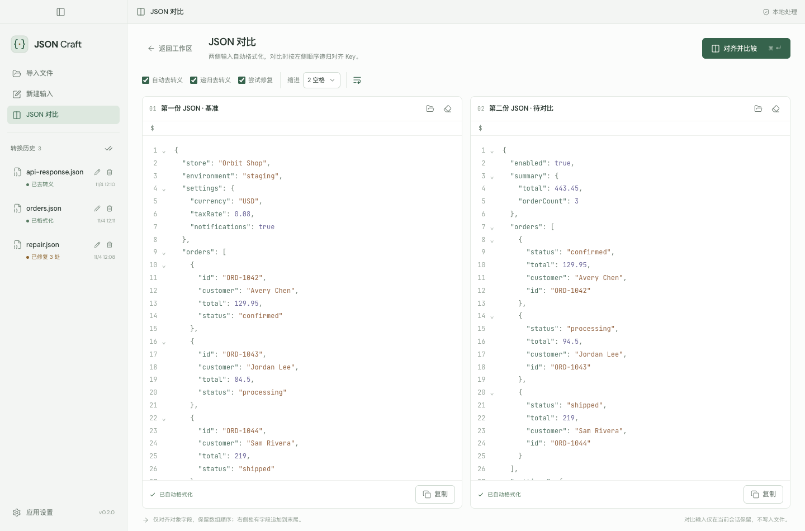
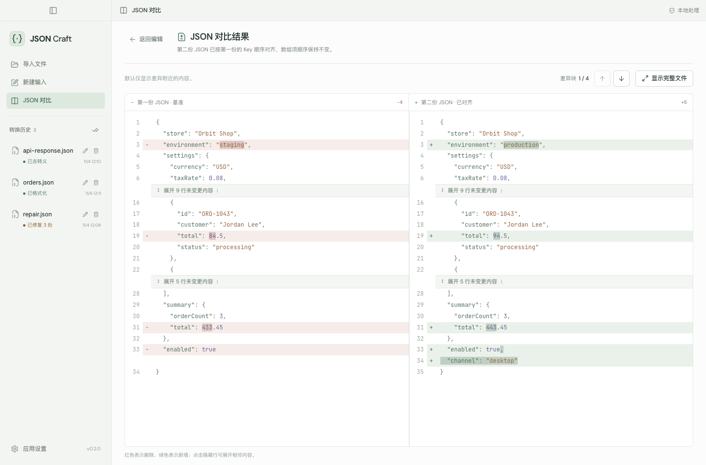
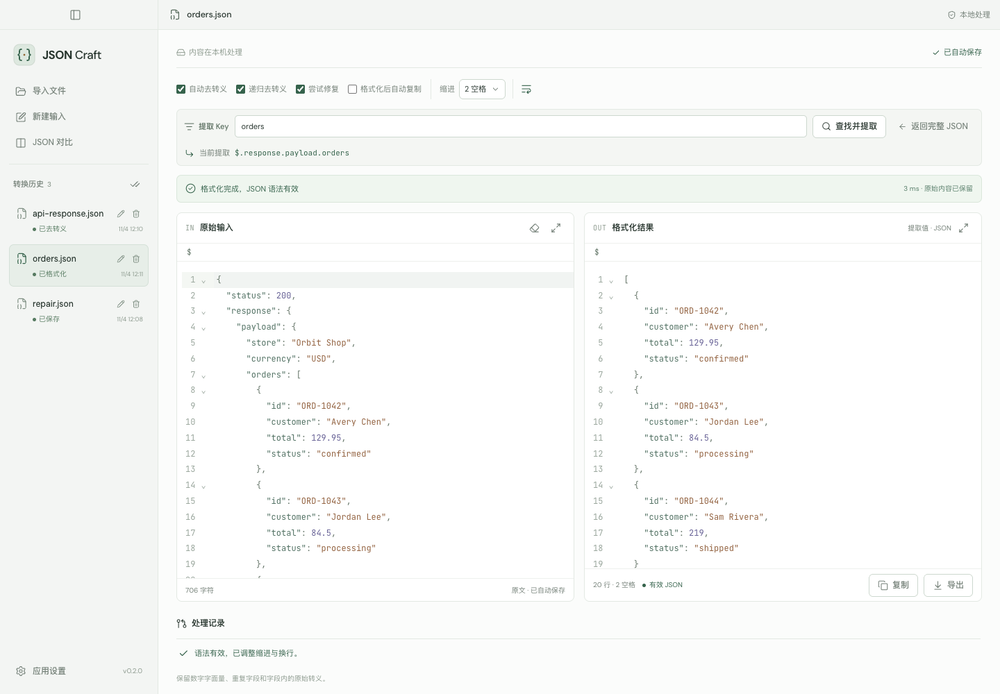
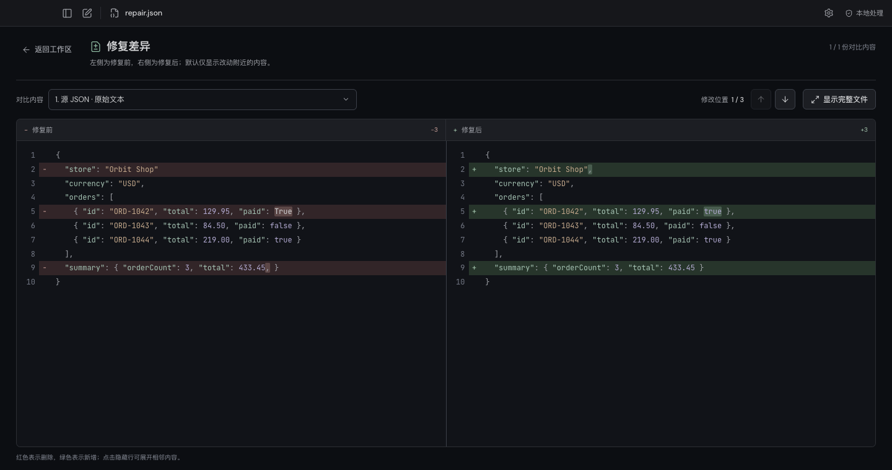

# JSON Craft

让杂乱的 JSON 清晰可读，让差异一目了然。

[English](README.md) · **简体中文**

一个在本机处理数据的 macOS / Windows JSON 工作台，支持格式化、修复、提取与对比。粘贴压缩后的接口响应、打开文件，或一次拖入多个文件，即可自动格式化，并保留原始输入。

[下载最新版本](https://github.com/HANYIIK/json-craft/releases/latest) · [反馈问题](https://github.com/HANYIIK/json-craft/issues)

## 可以做什么

- **格式化与去转义。** 将压缩 JSON 整理为可读文本，去除外层 JSON 字符串包装；也可选择递归展开嵌套对象和数组中的 JSON 字符串，普通文本和 Markdown 链接保留原样。
- **修复语法，并说明改了哪里。** 使用 `jsonrepair` 修复常见 JSON 语法错误，查看具体修改，并在独立的差异页面对比修复前后内容。
- **对比两份 JSON。** 先自动格式化，再按第一份 JSON 的顺序递归对齐第二份的对象 Key，查看剩余差异；保留数组顺序，两侧独有字段仍会展示。
- **按 Key 提取值。** 递归检索所有层级；同名字段出现多次时，先选择完整路径，再单独格式化、复制或导出对应值。
- **查看时始终有上下文。** 支持查找替换、对象和数组折叠、折叠数组项数、父级路径跳转，以及让任意一侧编辑器独占应用内容页。
- **处理多个文件。** 多选导入或拖入 `.json` 文件，切换历史记录、修改文件名；删除前确认，将关联文件移入系统废纸篓或回收站。
- **自动保存工作。** 原始输入工作区的内容和修改自动保存，可指定读取目录、JSON 文件目录及历史目录；一键复制、导出，也可开启格式化后自动复制。
- **按习惯使用。** 支持浅色、深色与跟随系统，中英文即时切换，偏好会在下次启动时保留。

JSON 内容全部在本机处理，无需账号、上传或云服务。文件使用 UTF-8，每个文件最多 **20 MiB**。

## 下载与安装

在 [Releases](https://github.com/HANYIIK/json-craft/releases/latest) 选择与你的系统和芯片对应的安装包。

| 平台                                    | 安装包                                                                                                                      | 其他格式                                                                                               |
| --------------------------------------- | --------------------------------------------------------------------------------------------------------------------------- | ------------------------------------------------------------------------------------------------------ |
| macOS 13+ · Apple Silicon（M 系列芯片） | [Apple Silicon DMG](https://github.com/HANYIIK/json-craft/releases/download/v0.2.0/JSON-Craft-0.2.0-macOS-arm64.dmg)        | [ZIP](https://github.com/HANYIIK/json-craft/releases/download/v0.2.0/JSON-Craft-0.2.0-macOS-arm64.zip) |
| macOS 13+ · Intel 芯片                  | [Intel DMG](https://github.com/HANYIIK/json-craft/releases/download/v0.2.0/JSON-Craft-0.2.0-macOS-x64.dmg)                  | [ZIP](https://github.com/HANYIIK/json-craft/releases/download/v0.2.0/JSON-Craft-0.2.0-macOS-x64.zip)   |
| Windows · x64                           | [Windows x64 安装程序](https://github.com/HANYIIK/json-craft/releases/download/v0.2.0/JSON-Craft-0.2.0-Windows-x64.exe)     | —                                                                                                      |
| Windows · ARM64                         | [Windows ARM64 安装程序](https://github.com/HANYIIK/json-craft/releases/download/v0.2.0/JSON-Craft-0.2.0-Windows-arm64.exe) | —                                                                                                      |

**macOS：** 打开 DMG，将 JSON Craft 拖入“应用程序”；或解压 ZIP 后将 App 移入“应用程序”。当前版本使用 ad-hoc 签名，**尚未经过 Apple 公证**。如果首次打开被系统拦截，请在“**系统设置 → 隐私与安全性 → 仍要打开**”中查看提示，并仅为从本仓库下载的文件确认打开，详见 [Apple 官方打开说明](https://support.apple.com/en-us/102445)。

**Windows：** 运行安装程序并选择安装目录。当前版本**没有经过验证的发布者证书**，Windows 可能显示未知发布者或 SmartScreen 提示，请先确认下载来源及文件，再决定是否继续。

每个 Release 都提供 `SHA256SUMS`，可用于核对下载文件；发布流程会先验证打包后的应用，再发布完整的安装包集合。

## 快速上手

1. 将 JSON 粘贴到“**原始输入**”，或点击“**导入文件**” / 直接拖入文件。
2. 在“**格式化结果**”查看自动更新的内容；按需开启或关闭递归去转义，决定是否展开内部 JSON 字符串。
3. 只需要某个字段时，在“**提取 Key**”中输入名称；出现多个匹配时，选择要处理的完整路径。
4. 点击结果下方的“**复制**”或“**导出**”；需要核对修复时，打开“**查看差异**”。

### 排除 Key 顺序干扰，对比两份 JSON

在侧栏“新建输入”下方打开“**JSON 对比**”，分别粘贴或导入两份 JSON，也可以一次将两个 `.json` 文件拖入对比页面。两侧会根据自动去转义、递归去转义、修复与缩进选项自动格式化。

点击“**对齐并比较**”进入差异页面。同一路径的对象字段按第一份 JSON 的 Key 顺序排列，第二份独有字段追加到末尾；数组中的对象按下标对应，但数组项本身不会重排。Key 对齐保留原有值、数字字面量和重复 Key。

默认只展示差异附近的内容，可逐处跳转、展开隐藏行或选择“**显示完整文件**”；点击“**返回编辑**”可修改后再次比较，切换格式化选项时会重新处理原始文本。

在本次会话中切换页面会保留对比草稿；草稿不会写入文件或转换历史，关闭应用后会清空。

### 只提取需要的内容

接口响应中的字段可能是对象、数组，也可能是一个被转义的 JSON 字符串。Key 提取可以检索所有层级，单独处理选中的值，同时保留源 JSON。

### 核对每一处修复

差异页面用红色表示删除、绿色表示新增，默认只展示改动附近的内容；可以展开隐藏部分、查看完整文件，也可以通过上一处 / 下一处按钮逐个定位。

## 文件与数据如何保存

- **原始输入自动落盘。** 新建输入及后续修改会保存为你指定 JSON 文件目录下的普通 `.json` 文件；未写完或语法无效的内容也会按原样保留。
- **结果单独复制或导出。** 复制和导出使用当前展示的格式化结果或提取值，不会自动覆盖原始输入。
- **对比使用独立工作区。** 在“JSON 对比”中导入或修改内容，不会修改源文件、创建转换历史或自动保存对比草稿。
- **历史用于恢复工作区。** 历史目录保存内部记录、格式化选项和提取状态；读取目录决定导入文件时优先打开的位置。
- **导入时避免覆盖。** 从其他目录导入的文件会复制到 JSON 文件目录；两个目录相同时，直接使用原文件。
- **删除前必须确认。** 弹窗会展示关联文件路径；确认后将该文件移入系统废纸篓或回收站，并删除对应历史。如果导入时创建的是副本，独立的外部原文件会保留。

修复可能推断缺失内容，使用修复结果前请核对修改。普通格式化保留数字字面量、重复 Key 和合法转义；开启递归去转义时，嵌套的 JSON 字符串会有意转换成对象或数组。

### 当前限制

包含大量转义内容的超长 JSON 字符串行，在差异页面中仍可能显示不全；底层 JSON 内容及完整复制、导出结果会保留。

## 反馈

遇到问题或有新功能建议，欢迎 [提交 Issue](https://github.com/HANYIIK/json-craft/issues)，并尽可能提供系统、应用版本及已脱敏的最小示例。

基于 Electron、React、CodeMirror 和 [jsonrepair](https://github.com/josdejong/jsonrepair) 构建。
