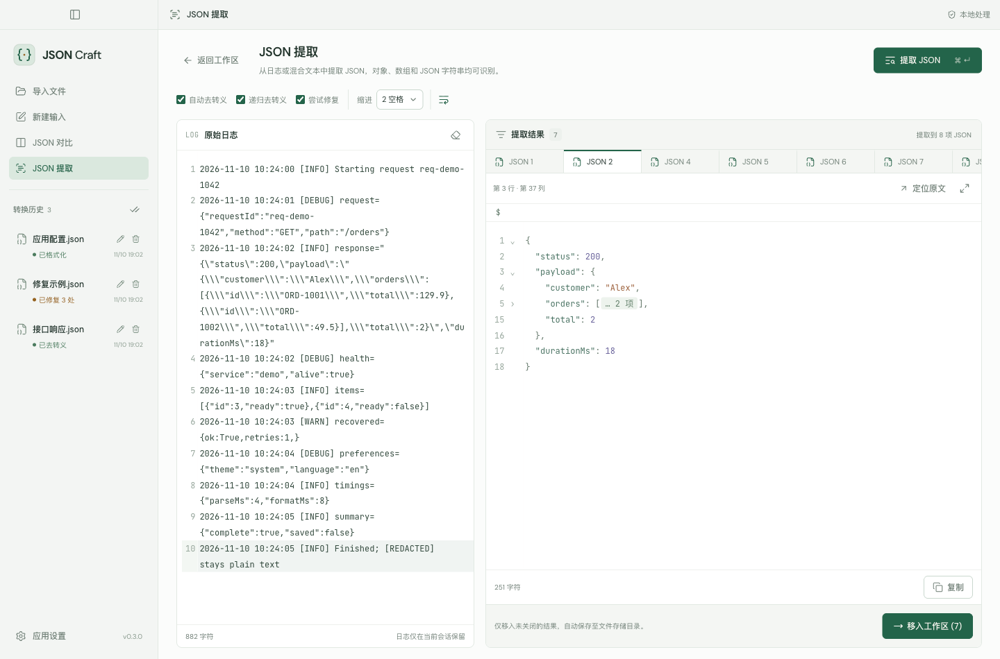
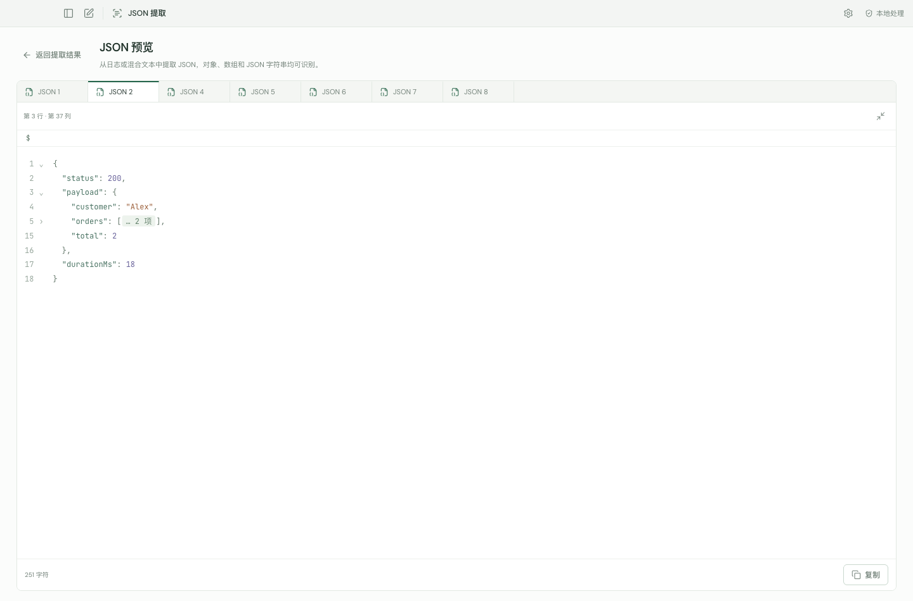

[English](README.md) | **简体中文**

# JSON Craft

### 离线 JSON 格式化、修复、对比与日志提取工具

适用于 macOS 和 Windows 的 JSON 工作台。格式化、修复、对比和提取 JSON，全部在本机完成，无需上传数据。

  
  

[下载](https://github.com/HANYIIK/json-craft/releases/latest) · [反馈问题](https://github.com/HANYIIK/json-craft/issues)

如果 JSON Craft 对你有帮助，欢迎在 GitHub 上点个 [⭐](https://github.com/HANYIIK/json-craft)。

## 主要功能

| 功能               | 可以做什么                                                                               |
| ------------------ | ---------------------------------------------------------------------------------------- |
| **格式化与去转义** | 将压缩 JSON 整理为可读文本，去除外层字符串包装，也可递归展开对象和数组中的 JSON 字符串。 |
| **JSON 修复**      | 修复常见语法错误，通过并排差异视图核对每一处修改。                                       |
| **JSON 对比**      | 对比两份 JSON，排除仅由对象 Key 顺序不同造成的差异，保留数组顺序。                       |
| **JSON 提取**      | 从日志中找出多个 JSON 对象、数组和编码字符串，支持预览、复制和保存结果。                 |
| **按 Key 提取值**  | 查找任意层级的字段并单独处理其值；同名字段出现多次时，可选择具体路径。                   |
| **编辑与文件管理** | 支持查找替换、内容折叠、父级路径跳转、放大编辑器及已保存文件的管理。                     |
| **外观与语言**     | 支持浅色、深色、跟随系统，以及中文与英文即时切换。                                       |

无需账号或联网，支持 UTF-8 编码的 JSON 文件，单个文件最大 **20 MiB**。

## 下载

| 平台                                    | 安装包                                                                                                                                                                                                          |
| --------------------------------------- | --------------------------------------------------------------------------------------------------------------------------------------------------------------------------------------------------------------- |
| macOS 13+ · Apple Silicon（M 系列芯片） | [DMG](https://github.com/HANYIIK/json-craft/releases/download/v0.4.0/JSON-Craft-0.4.0-macOS-arm64.dmg) · [ZIP](https://github.com/HANYIIK/json-craft/releases/download/v0.4.0/JSON-Craft-0.4.0-macOS-arm64.zip) |
| macOS 13+ · Intel                       | [DMG](https://github.com/HANYIIK/json-craft/releases/download/v0.4.0/JSON-Craft-0.4.0-macOS-x64.dmg) · [ZIP](https://github.com/HANYIIK/json-craft/releases/download/v0.4.0/JSON-Craft-0.4.0-macOS-x64.zip)     |
| Windows · x64                           | [EXE](https://github.com/HANYIIK/json-craft/releases/download/v0.4.0/JSON-Craft-0.4.0-Windows-x64.exe)                                                                                                          |
| Windows · ARM64                         | [EXE](https://github.com/HANYIIK/json-craft/releases/download/v0.4.0/JSON-Craft-0.4.0-Windows-arm64.exe)                                                                                                        |

**macOS：** 打开 DMG，将 JSON Craft 拖入“应用程序”，或解压 ZIP 使用。当前安装包尚未经过 Apple 公证；如果首次打开被拦截，请参考 [Apple 官方打开说明](https://support.apple.com/en-us/102445)。

**Windows：** 运行 EXE 安装程序。当前安装包未签名，Windows 可能显示未知发布者或 SmartScreen 提示。

[发布页面](https://github.com/HANYIIK/json-craft/releases/latest)提供 `SHA256SUMS`，可用于校验下载文件。

## 开始使用

1. 将 JSON 粘贴到“**原始输入**”，导入文件或直接拖入文件，格式化结果会自动更新。
2. 按需选择是否展开嵌套 JSON 字符串、修复语法，再“**复制**”或“**导出**”结果。
3. 需要对比两份数据时打开“**JSON 对比**”；需要从日志中查找 JSON 时打开“**JSON 提取**”。

### 对比 JSON

在两侧分别粘贴或导入内容，点击“**对齐并比较**”，即可查看新增与删除、逐处跳转差异，或展开未修改部分查看上下文。

### 从日志中提取 JSON

粘贴日志并点击“**提取 JSON**”，通过标签页浏览结果，关闭不需要的项，再点击“**移入工作区**”，即可将剩余结果保存为 JSON 文件。

## 保存方式

主工作区的输入会自动保存为所选目录中的 `.json` 文件，格式化结果可单独复制或导出。对比草稿和日志提取结果仅在当前会话保留；需要在关闭应用后保留提取结果，请先将其移入工作区。

悬停历史记录并打开“**⋯**”，即可置顶、修改名称或删除。置顶记录优先显示，每组均按最近编辑时间倒序排列。

更多截图

## 反馈

有疑问、发现问题或希望增加功能？欢迎[提交 Issue](https://github.com/HANYIIK/json-craft/issues)。
